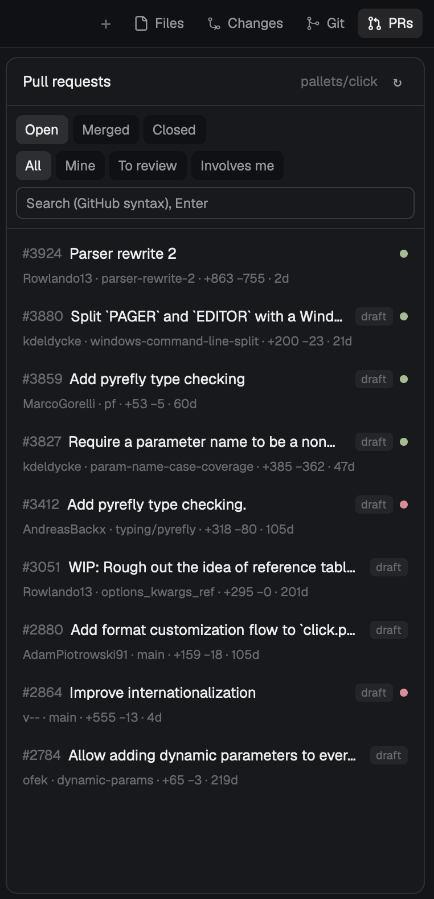

# Pull requests panel for Herdr

A side panel for the [Herdr](https://herdr.dev) desktop app: the pull requests of the focused space's GitHub repo,
with filters (Open / Merged / Closed, All / Mine / To review / Involves me, GitHub search), details (checks,
reviews, description), and one-click checkout into a Herdr worktree space.



## Install

Ask your Herdr agent: *"add the mod at github.com/dadodimauro/herdr-prs"*. Or by hand:

```sh
git clone https://github.com/dadodimauro/herdr-prs
cp -R herdr-prs/mods/prs ~/.config/herdr-app/mods/
herdr-app check ~/.config/herdr-app/mods/prs
```

Then add a **PRs** button beside Files and Changes: [RECIPE.md](RECIPE.md), "A panel button". It needs `gh`
(logged in). **Check out + review** starts `claude /herdr-review`
([herdr-review](https://github.com/dadodimauro/herdr-review)).

[RECIPE.md](RECIPE.md) is the full brief to build it from an empty folder.
