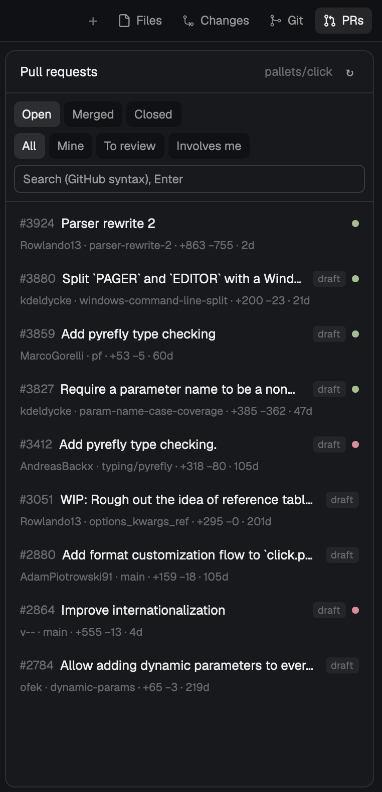

# Pull requests

A side panel that lists the pull requests of the focused space's GitHub repo, with GitHub's filters: Open, Merged
or Closed, and All, Mine, To review or Involves me, plus a search box that takes GitHub's search syntax. Click a PR
for its details (checks, reviews, description). One click checks it out into a new Herdr worktree space, and can
start Claude Code there with a review command.

## What you see

One column on `background`, radius 10, 1px `border`, base text 13px. Top to bottom:

- **Header**, 42px, 14px side padding, bottom border: "Pull requests" semibold; on the right, in `dim` 12px,
  truncated, the repo (`owner/name`) or `#<n>` when a PR is open; then the refresh button: `↻` in `muted`
  (`foreground` on hover), or a turning 12px spinner while a load runs. In the details, a `←` back button (20px)
  comes first and there is no refresh button.
- **Filters**, 8px padding, 6px gaps, bottom border: a row of pills Open / Merged / Closed, a wrapping row All /
  Mine / To review / Involves me, then a 28px search box (radius 6, 1px `input` border, `surface`, 12px text,
  placeholder "Search (GitHub syntax), Enter"). Pills: 12px text, padding 8×3, radius 6; the chosen one `selected`
  with `foreground` text, the others `chrome` with `muted` text, `hover` under the pointer.
- **List**, scrolling, 4px padding. Each PR is a row (padding 10×7, radius 7, `hover`): first line `#<n>` in `dim`
  12px, the title (truncated), then chips and a dot; second line in `dim` 11px: `author · head branch · +adds −dels
  · age` (`5m`, `3h`, `2d`). Chips (10px text, padding 5, radius 4, color at 15% behind the color): `draft`
  (`dim`), `approved` (`ansi2`), `changes` (`ansi1`). The 7px dot is the CI state: `ansi2` all passed, `ansi1` a
  failure, `ansi3` still running, no dot without checks.
- **Loader**: on the first load "Loading pull requests…"; when you press refresh, change a filter or search,
  "Refreshing pull requests…" at the top of the list, with a 14px spinner in `accent`, 12px `muted` text, 10px
  vertical padding. The old rows stay below it at 40% opacity. The 60-second auto refresh shows only the header
  spinner.
- **Empty and errors**: "No pull requests" (`dim`), or the error in `ansi1` ("This space is not in a git
  repository.", gh's message).
- **Details**, scrolling, 12px padding, 8px gaps: the title at 15px semibold; the chips and dot, then `author · head
  → base` (`muted` 12px); `+adds −dels · N files · updated 2d ago · from a fork` (`dim` 12px); the checks line
  ("Checks pass" `ansi2`, "Checks running" `ansi3`, or "Checks failing: <up to 4 names>" `ansi1`); "Reviews: name
  (approved), …" (`muted`); the buttons; a busy line ("Getting <branch>…"); a top border; then the description as
  Markdown (12px, selectable), or "Loading the description…". Buttons: 28px tall, padding 10, radius 6, 12px, 1px
  border: **Check out + review** (`solid` with `solid_foreground`), **Check out** and **GitHub ↗** (`raised`,
  `input` border). While a checkout runs, buttons are at 50% opacity and do nothing.

## How it behaves

- Agent statuses (working, blocked, done, idle) are not shown: this is a GitHub view.
- **Which repo**: where the active space is now, as Herdr's Files panel finds it: the focused pane's `cwd`, else
  `focused().cwd`, else the space folder, on the space's machine. `git rev-parse --show-toplevel`, then `gh repo view
  --json nameWithOwner`. When that place changes (render compares it), the panel loads again for the new repo.
- **Load**: `gh pr list --state <open|merged|closed> --limit 60 --json number,title,author,headRefName,baseRefName,
  isDraft,reviewDecision,updatedAt,isCrossRepository,additions,deletions,statusCheckRollup,url,labels`, with
  `--search "<who> <search text>"` when there is one (`author:@me`, `review-requested:@me`, `involves:@me`). Timeout
  60 s. Every 60 s again. A filter or search during a load waits and loads once more after it, so the list always
  matches the filters.
- **CI state** from `statusCheckRollup`: a conclusion or state `FAILURE`, `ERROR`, `TIMED_OUT`, `CANCELLED`,
  `ACTION_REQUIRED` or `STARTUP_FAILURE` → failure; a `CheckRun` not `COMPLETED`, or a state `PENDING` or
  `EXPECTED` → running; else passed.
- **Click a row**: the details open at once with the list's data, then `gh pr view <n> --json <list fields>,body,
  state,changedFiles,mergeable,reviews,createdAt` fills them. Reviews keep the last non-comment state per person.
- **Check out**: a Herdr worktree space on the PR's branch.
  - A worktree of that branch exists (`git worktree list --porcelain`): select the space that shows it, or make
    one there (`space.new`), and post a toast "#<n> is already checked out".
  - A fork's PR: `git fetch origin pull/<n>/head:pr/<n>` (never forced: a local `pr/<n>` with other commits stays,
    with a warning toast).
  - A PR from the same repo: `git fetch origin +refs/heads/<b>:refs/remotes/origin/<b>`, then `git branch --track
    <b> origin/<b>` when the branch does not exist.
  - Then Herdr's shipped worktree dialog makes the checkout and the space: `openOverlay({mod: "worktree", kind:
    "dialog", width: 440, height: 260, props: {folder: <repo top>, machine, branch, argv}})`.
- **Check out + review**: the same, with `argv: ["claude", "/herdr-review"]`: the new space starts Claude Code with
  that command (the review skill at github.com/dadodimauro/herdr-review; change the argv for another agent or
  command).
- **GitHub ↗**: `open <url>`.
- Errors of a checkout post an error toast with git's message.

## Built from

- `mods/prs/`: `main.js` (one `View`), `mod.json` `{ "place": "none", "title": "pull requests" }` (no dock of its own),
  `pr.svg` (the tab-bar icon), `spinner.svg` (a ring with a quarter arc, `stroke="currentColor"`).
- Imports: `View`, `div`, `svg` from `gpui-kit`; `v_flex`, `h_flex`, `Input`, `InputState`, `TextView` from
  `gpui-base`; `checking`, `exec`, `focused`, `notify`, `openOverlay`, `panes`, `run`, `spaces`, `theme` from
  `herdr`.
- Spinners: `svg(SPINNER).spin(900)`, never a timer.
- **A panel button** (as Herdr's Files and Changes): clone Herdr's `tabs` mod and `main` layout. In the tabs clone,
  add `"prs"` to the enabled panels (`const enabled = [...(shared("workspace.panels") ?? ["files", "changes"]),
  "prs"]`) and add `.child(panelButton("prs", "PRs", "mods/prs/pr.svg"))` after the Changes button. In the layout
  clone, set the `tabs` block's `content.mod` to the tabs clone and add `{ "id": "prs", "type": "block", "content":
  { "mod": "prs" } }` to the stack with `"id": "panel-body"`.
- Programs: `git`, `gh` (logged in), `open` (macOS).

## Watch out

- `render()` calls `refresh()` when the space changes, so `refresh()` must not call `cx.notify()`; each click
  handler calls it instead, or the loader shows only after the load.
- `refresh()` during a load must not drop the request: set a flag and load again after the current load.
- `.when(cond, …)` needs a real boolean (`Boolean(this.busy)`).
- Don't force-fetch a fork PR into `pr/<n>`: it can hold the user's own commits.
- `gh pr list --search` adds to `--state`; `involves:@me` needs a logged-in `gh`.

## Done when

- `herdr-app check ~/.config/herdr-app/mods/prs` passes.
- In a space in a GitHub repo, the panel lists its open PRs with chips and CI dots; Merged and Closed switch the list.
- Mine, To review and Involves me filter by the logged-in user; a search (`label:bug`) filters on Enter.
- Pressing refresh shows the spinner and the dimmed list until the new list is in.
- Clicking a PR shows its checks, reviews and description; `←` goes back.
- Check out opens Herdr's worktree dialog on the PR branch; for a branch with a worktree, its space is selected.
